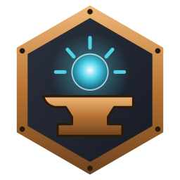

<p align="center"></p>

<p align="center">
<a href="https://github.com/mflr0/Arkeyan-Launcher/releases/latest"></a>
<a href="https://github.com/mflr0/Arkeyan-Launcher/releases"></a>
<a href="https://github.com/mflr0/Arkeyan-Launcher/actions/workflows/build.yml"></a>
<a href="https://github.com/mflr0/Arkeyan-Launcher/issues"></a>
<a href="https://github.com/mflr0/Arkeyan-Launcher/milestone/5"></a>

<a href="https://discord.gg/UMQY4SAS3F"></a>
<a href="LICENSE"></a>
</p>

# Arkeyan Launcher: native Skylanders on PC, macOS and Linux

**Play Skylanders natively on Windows PC, macOS, Linux and the Steam Deck.** Arkeyan Launcher turns your own Xbox 360
disc of *Spyro's Adventure*, *Giants*, *Swap Force*, *Trap Team*, *SuperChargers* or *Imaginators* into a real PC game, by
static recompilation: no emulator, sharper than the console at up to 60 FPS, your figures on a virtual portal (or your
real Portal of Power), any controller, the keyboard or the mouse, and two players on one screen. Drop your disc image on
the window, click INSTALL, then PLAY. Formerly Skylauncher: it updates itself to this version.

<p align="center"><a href="https://github.com/mflr0/Arkeyan-Launcher/releases/latest"><b>Download</b></a> ·
<a href="https://discord.gg/UMQY4SAS3F"><b>Join the Discord</b></a> ·
<a href="#get-help">Get help</a> ·
<a href="#wanted-uiux-designers">UI/UX designers wanted</a></p>

<!-- SCREENSHOTS: four gameplay pictures (one per game), hosted outside the repository -->

Arkeyan Launcher contains no game code and no game art. Everything shown from the game is read from your own disc and stays
on your computer.

## What you get

- **Native games**, built once on your computer from your disc (2 to 4 minutes on an Apple Silicon Mac), at a higher resolution
  than the console's, at 30 or 60 FPS.
- **AMD FSR 3** upscaling, a switch in the game's settings (frame generation comes later), **HD textures** made from your disc,
  and **5.1 sound** when your speakers have six channels.
- **No portal needed.** Your figures live in the **Toy Box**: put any of them on the virtual portal from the game (F6), swap
  in one press, create figures from the catalogue, choose the villain in a trap. A real Portal of Power works too,
  even beside a virtual figure for the second player.
- **Any controller, the keyboard or the mouse**, every key and button remappable, button pictures that match your device.
- **Your saves are safe**: written in one go, earlier versions kept, restored in two clicks.
- **Updates in one click**, for the launcher and each game, checked against the release's SHA-256.
- **A portable copy** of an installed game in one file, to play it anywhere without the launcher.
- **Two players on one computer**, each with a controller and a figure, real or virtual.
- **Profiles**, each with its own Toy Box, saves, keys and achievements, and the games' **achievements** in the launcher.
- **Discord Rich Presence**: your friends see the game, the level you are in, your Skylander and how long you have played
  (Settings > Launcher > Discord to turn it off).
- **The launcher in eleven languages**: English, French, German, Spanish, Italian, Portuguese, Dutch, Swedish, Norwegian,
  Danish and Finnish.
- **Each system's own graphics**: Direct3D 12 on Windows (or Vulkan, a choice in each game's settings), Metal on macOS,
  Vulkan on Linux.

Coming later: online co-op, frame generation, custom texture packs, and SuperChargers Racing, Cloud Patrol and Lost
Islands.

## The games

| Game | Mac | Windows | Linux | Played so far |
|---|---|---|---|---|
| Spyro's Adventure | ✅ | ✅ | ✅ | 27 story levels and the Ruins played with a hero; bosses and Heroic Challenges not all confirmed |
| Giants | ✅ | ✅ | ✅ | Chapter 1, and 78 of its 91 levels in an automatic tour; a real portal on Linux |
| Swap Force | ✅ | ✅ | ✅ | The tutorial, the first area of the story and the two-player arenas; 158 of 195 zones in an automatic tour |
| Trap Team | ✅ | ✅ | ⚠️ not tested yet | The tutorial, the first chapters and the Academy, a villain captured and kept in its trap; 53 of 56 levels in an automatic tour |
| SuperChargers | ✅ | ✅ | ✅ (Steam Deck) | The opening and the Academy, a vehicle on the portal |
| Imaginators | ✅ | ✅ | ⚠️ not tested yet | The opening and the hub |

✅ means played on a real computer of that kind, by the author or by players; each one has its evidence (an issue or a
tester's log) on the game's status page in the [forge](https://github.com/arkeyan-forge/forge). The Steam Deck works in
Game Mode and in Desktop Mode.

Finished a game, or played one on Windows or Linux? Please say so in an
[issue](https://github.com/mflr0/Arkeyan-Launcher/issues): it is how this table gets filled.

**Testers wanted**, above all on Linux, on the Steam Deck, with Xbox portals, and with Imaginators on Windows. Join the
[Discord](https://discord.gg/UMQY4SAS3F) to help test new versions before they ship.

**Your portal can help.** Portals for the Wii, Wii U, PlayStation and PC all work the same way; the Xbox 360 and Xbox One
ones differ from model to model, and not all of them are known yet. If the launcher doesn't find yours, or finds it but
can't use it, please open an [issue](https://github.com/mflr0/Arkeyan-Launcher/issues) with:
- the console and game it came with, and the model number under its base;
- what Settings > Controls > Portal of Power > **Test** shows (press **Copy** and paste it);
- on Windows, its **Hardware Ids** (Device Manager > the portal > Properties > Details); on Linux, the `lsusb` line.

Known so far: `1430:0150` (Wii, Wii U, PlayStation, PC), `1430:1F17` (Xbox 360), `1430:09AA` (Xbox One, Trap Team).

## Tested

Every release is checked before it ships, on the six games:

- **A clean install of each game** from the release's own kit, then its first level played by a script in a real window
  (movies on, figures on the virtual portal, frames captured).
- **The full test suite**: each game built from its disc, started and played for a few minutes (frame rate, sound, the
  picture compared with a reference, saves, figures), and thousands of unit checks (figures, saves, the portal, the
  Toy Box, settings, the launcher's install, update and uninstall paths, damaged disc images).
- **Automatic level tours** that load every level of each game one by one.
- **The code translator** is proved against its reference on all 4,294,967,296 possible PowerPC instruction words.
- The Windows and Linux builds of Spyro's Adventure, Giants and Swap Force also run in Wine and in a container.
- Before release, the author checks each version on a Mac, a Windows PC with an NVIDIA card and a Linux PC, with real
  portals.

## What you need

- Your own copy of *Skylanders: Spyro's Adventure*, *Skylanders: Giants*, *Skylanders: Swap Force*, *Skylanders: Trap Team*, *Skylanders: SuperChargers* or *Skylanders: Imaginators* for Xbox 360, as a disc image (`.iso`).
- Windows 10 or 11 (64-bit), a Mac with Apple Silicon, or a Linux PC (below).
- Apple Silicon Mac required (M1 or later).
- An internet connection the first time: INSTALL downloads the game tools (about 30 to 40 MB) and the compiler.
- **Linux:** an x86_64 PC with a Vulkan driver (Mesa or NVIDIA), about 6 GB free, and a distribution from 2022 or later
  (glibc 2.34+: Ubuntu 22.04+, Fedora, Arch; SteamOS on the Steam Deck). No compiler or root is needed: INSTALL
  downloads zig (55 MB) as the compiler. A real portal needs udev rules once (Wii, Wii U, PlayStation and PC portals, then every Activision USB device: the Xbox 360 portal `1430:1F17` and the Xbox One portal `1430:09AA`), the only step that needs `sudo` (on
  the Steam Deck, set a password with `passwd` first):

  ```sh
  printf '%s\n' 'SUBSYSTEM=="hidraw", ATTRS{idVendor}=="1430", ATTRS{idProduct}=="0150", MODE="0660", TAG+="uaccess"' 'SUBSYSTEM=="usb", ATTRS{idVendor}=="1430", MODE="0660", TAG+="uaccess"' 'SUBSYSTEM=="usb", ATTRS{idVendor}=="24c6", ATTRS{idProduct}=="fa00", MODE="0660", TAG+="uaccess"' | sudo tee /etc/udev/rules.d/70-skylanders-portal.rules
  sudo udevadm control --reload-rules && sudo udevadm trigger
  ```

  Then unplug the portal and plug it in again.

## Supported discs

Xbox 360 discs only.

| Game | Regions | Languages |
|---|---|---|
| Spyro's Adventure | USA, Europe | English, French, German, Spanish, Italian, Dutch, Swedish, Norwegian, Danish, Finnish |
| Giants | USA, Europe | English, French, German, Spanish, Italian, Dutch, Portuguese, Swedish, Norwegian, Danish, Finnish |
| Swap Force | USA, Australia, Europe | English, French, Spanish, Italian |
| Trap Team | Europe, USA | English, German, French, Dutch |
| SuperChargers | Europe | English, German |
| Imaginators | Europe, USA | French, Dutch |

Another edition whose game code is the same as a supported one (only the disc's header differs: another region, media ID or version) is accepted as that edition. Any other edition is refused with a message. If you have one, click **Find my edition** under that message: the game tools read your disc and copy a short report (its IDs, region, languages and fingerprints, and which addresses of the game they found in it). Open a [New disc edition](https://github.com/mflr0/Arkeyan-Launcher/issues/new?template=new_disc_edition.yml) issue and paste it. Never attach the disc image or game files.


## Get started

1. Download Arkeyan Launcher from the [Releases page](https://github.com/mflr0/Arkeyan-Launcher/releases):
   - **Windows:** `ArkeyanLauncher.exe`. If SmartScreen warns you, choose More info, then Run anyway. If Windows Defender
     reports a trojan such as `Bearfoos`, read [Windows Defender alerts](#windows-defender-alerts).
   - **Mac:** `ArkeyanLauncher-macOS.dmg`. The app is not notarized: the first time, macOS blocks it; go to System Settings > Privacy & Security and choose Open Anyway (macOS 14 and earlier: right-click the app and choose Open).
   - **Linux:** `ArkeyanLauncher-x86_64.AppImage`, after `chmod +x`.
2. Drop your `.iso` on the window, or click the button to choose it. The disc is checked.
3. Click **INSTALL**. The game is built from your disc, once: a few minutes (2 to 4 on an Apple Silicon Mac, more on a
   slower computer).
4. Click **PLAY**.

## Controls

Any gamepad works: Xbox, PlayStation, Switch and others. You can also play on the keyboard, and change every key in
Settings > Controls or in the game's F3 menu > Commands.

**Mouse:** turn it on per game (the game's keys page, or F3 > Commands). Left click is attack 1, right click attack 2, and
every mouse button and the wheel can take any action. The game holds the pointer while you play and lets it go in the F3
menu, the Toy Box, on Alt-Tab and when the window loses focus; a click in the window takes it back.

The launcher shows live whether a real Portal of Power is plugged in ("Portal: <model>" or "Portal: not detected"), next
to PLAY and on the Collection page.

| Action | Gamepad | Keyboard |
|---|---|---|
| Move | Left stick | W A S D |
| Camera | Right stick | I J K L |
| A | A | Space |
| B | B | X |
| X | X | C |
| Y | Y | V |
| Pause | Start | Enter |
| Back | Back / View | Backspace (Escape also goes back in menus) |
| LB / RB | LB / RB | Q / E |
| LT / RT | LT / RT | 1 / 3 |
| D-pad | D-pad | Arrow keys |

In Trap Team, LT (1 on the keyboard) switches between your Skylander and the villain in your trap.

On-screen buttons can show Xbox 360, Xbox One / Series, PlayStation, Nintendo or keyboard glyphs (Settings > Controls).

### Figures and the Toy Box

You don't need a real Portal of Power. The game has a virtual portal, and your figures live in the **Toy Box**.

| | Gamepad | Keyboard / mouse |
|---|---|---|
| Open the Toy Box | View + Y | F6, or tap Tab |
| Quick swap wheel | Hold View | Hold Tab |
| Choose / back | A / B | Enter / Escape |
| Options of a figure | X | Right click |
| View menu (sort, group) | Y | F3 |
| Previous / next section | LB / RB | Page Up / Page Down |
| Take a figure off a seat | X, then Take off | Delete |

The **Collection** page of the launcher shows the same figures: their stats, backups, the trash, and the seats for the
next game. You can also create figures from the catalogue there, or a game's whole starter pack. Figures the chosen game
cannot read stay in the list, greyed.

For Trap Team, choose the villain a trap holds and whether it is evolved in the Collection, with the trap off the portal.
No capture needed. The Toy Box shows both.

**Toy Box window:** while a game runs, the On the portal card's **Toy Box window** opens the game's Toy Box in a window of its
own, to keep beside the game (on a second monitor): put figures on, swap players, take them off, and the game follows at
once. Tick **Open with the game** in it to have it with every game. With a real portal plugged in, one player can play a real
figure and the other a virtual one.

To use a real portal (Wii, PlayStation, Xbox 360 or Xbox One), plug it in and choose it in Settings > Controls >
Portal of Power. Then click **Test the portal**.

**Xbox 360 portal on Windows:** Windows has no driver that lets a program talk to it, so it needs Windows' own WinUSB
driver, once (nothing to download): in Device Manager, right-click the portal ("Spyro Portal", or an unknown device),
**Update driver** > **Browse my computer for drivers** > **Let me pick from a list** > **Universal Serial Bus devices** >
**WinUsb Device**, then unplug the portal and plug it in again. Zadig's WinUSB driver works the same way. The Xbox One
portal needs nothing: the game reaches it through Windows' own Xbox driver.

**A Wii, PlayStation or PC portal moved to another driver (Zadig) on Windows:** on WinUSB, the game uses it as it is. On
libusbK or libusb0, **Test the portal** shows the way back: in Device Manager, right-click the portal, **Uninstall device**,
tick **Attempt to remove the driver for this device**, then unplug the portal and plug it in again. If Windows puts that
driver back, open a Command Prompt as administrator and run `pnputil /enum-drivers`, then
`pnputil /delete-driver oemNN.inf /uninstall /force` with the driver's `oemNN.inf` (the Test names it, and **Copy
commands** copies both), then plug the portal in again.

## Settings

- **Resolution scale:** Auto picks x1 on integrated graphics and x2 on dedicated cards. If the game is slow, use x1.
- **Frame rate:** the default is 60 for Giants and Swap Force and 30 (the original) for Spyro's Adventure and Trap Team. 60 is
  experimental.
- **Portable mode:** put an empty file named `portable.txt` next to the launcher (on macOS, next to the app). The
  settings, saves, figures and games then live in a `data` folder beside it, for the launcher and for every game it
  starts. Move the folder and everything comes along.
- The launcher and the games share one settings file, `launcher.ini`.
- **Language:** the launcher is available in eleven languages (Settings, Launcher tab); System default follows your system's
  language. A game's own text and voices come from your disc (Supported discs, above).
- **Your saves are safe:** each save is written in one go, and the previous version is kept before it is replaced. To go
  back to one, open the game's settings (the gear next to PLAY) > Saves > Restore.

## Get help

- **Ask on the [Discord](https://discord.gg/UMQY4SAS3F)**: players and the author answer there, and new versions are tested
  there before they ship.
- **Report a bug** with an [issue](https://github.com/mflr0/Arkeyan-Launcher/issues/new/choose): the forms ask for what is
  needed (read [How to report a bug](https://github.com/mflr0/Arkeyan-Launcher/issues?q=is%3Aissue+is%3Apinned) first).
  The launcher's **Report a bug** button writes a report (your system, settings and logs, with your user name and
  folders removed) to attach.
- Settings (the gear) > Support > **Copy game log** copies the log to paste in the issue (or drop the `.txt` file into it).
  **Open logs folder** shows the files.
- Everything is in one "Skylanders" folder: `%APPDATA%\Skylanders\` on Windows, `~/Library/Application Support/Skylanders/`
  on Mac, `~/.local/share/Skylanders/` on Linux. The logs are in its `logs/` folder and in each game's folder.
- If the game stops with an error, a window offers Copy log and Report.
- Starting Arkeyan Launcher while it is already open brings its window to the front; a game's shortcut plays that game in it.
- Updates (Arkeyan Launcher's and each game's) are looked for at every start; an offline start says nothing. Every download is checked against the release's SHA-256.

## Windows Defender alerts

Windows Defender may flag `Arkeyan-Builder.exe` (the kit's builder), `ArkeyanLauncher.exe` or a game it builds as
`Trojan:Win32/Bearfoos.A!ml` (or `.B!ml`). The
`!ml` ending means no known malware was found: Defender's machine-learning model guessed, from what the program does. It is
a known false positive for small projects ([one of many reports](https://www.reddit.com/r/computerviruses/comments/1m4cd4n/bearfoos_trojan/)).
Arkeyan Launcher matches that guess on every point:

- **It is not signed.** A code-signing certificate costs hundreds of euros a year; a new unsigned program has no
  reputation with Microsoft yet, and each release starts again from zero.
- **It downloads and runs programs**: the game kit and a compiler, at INSTALL, then the game it builds on your PC.
- **It writes a new program on your PC**: the game is compiled from your disc, so its executable exists nowhere else and
  no antivirus has seen it before.
- **It updates itself** (it replaces its own executable), as a dropper would.

What you can check, and do:

- The source is all here, and every release is built by GitHub Actions from it (the Actions tab shows each build).
- Every download is checked against the release's SHA-256 before it runs.
- Restore the file from Windows Security > Protection history (Allow on device), and add an exclusion for
  `%APPDATA%\Skylanders\kit`. Reporting it to Microsoft as a false positive
  ([file submission](https://www.microsoft.com/wdsi/filesubmission)) helps every other player too.

## Build from source

You need CMake 3.20 or later, Ninja, a C++20 compiler (Clang) and git.

```sh
git clone --recursive https://github.com/mflr0/Arkeyan-Launcher.git
cd Arkeyan-Launcher
cmake -S . -B build -G Ninja -DCMAKE_BUILD_TYPE=Release
ninja -C build ArkeyanLauncher
```

The developer docs are in `docs/`: `launcher_ui.md` covers the screens and theme, `install.md` the install,
`collection_ui.md` the figures, `toybox_window.md` the Toy Box window, `updates.md` the updater and releases, `portable.md` the portable copy, and `support.md` the logs.

## Known issues

- Xbox 360 and Xbox One portals on Windows have not been confirmed on a real PC yet
  ([#29](https://github.com/mflr0/Arkeyan-Launcher/issues/29)): if you have one, please try it and tell us. Wii, Wii U,
  PlayStation and PC portals work everywhere.
- Giants: in a maximized window wider than 16:9, the menus can jitter
  ([#78](https://github.com/mflr0/Arkeyan-Launcher/issues/78)); setting Widescreen to 16:9 in the game's settings avoids it.
- Giants: some water and textures can flicker while a Skylander's ranged attack lights them (Bouncer, Swarm)
  ([#96](https://github.com/mflr0/Arkeyan-Launcher/issues/96)). Being fixed for 0.9.7.
- Swap Force: the core seen through the cage in the tutorial's volcano is drawn with dark streaks
  ([#80](https://github.com/mflr0/Arkeyan-Launcher/issues/80)).
- Trap Team: a Wii Traptanium portal can stop answering until the game restarts
  ([#99](https://github.com/mflr0/Arkeyan-Launcher/issues/99)). Fixed for 0.9.7.
- The mouse does nothing in the games' own menus yet: use the keyboard or a controller there.
- The Mac app is not notarized, and Windows SmartScreen or Defender may warn about the launcher (see
  [Windows Defender alerts](#windows-defender-alerts)).

## How it works

The ports are made by static recompilation: the game's PowerPC code is translated to C++ and its shaders to Metal,
Vulkan and Direct3D 12 shaders, on your computer, from your disc. A runtime written for these games replaces the Xbox 360
(memory, threads, files, graphics, audio, controllers, the Portal of Power).

Every change is checked by automatic tests: each game is built from its disc, started and played for a few minutes by a
script (frame rate, sound, the picture compared with a reference, saves, figures), and scripted tours load the games'
levels one by one. The Windows and Linux builds of Spyro's Adventure, Giants and Swap Force are also run in Wine and in a
container.

Everything here is made for this project: the launcher, the kits and the ports. The reverse engineering, the architecture
and every design decision are the author's own; AI tools write the code from that design and run the tests.

## Wanted: UI/UX designers

The launcher works; now it should feel like Skylanders. We are looking for **UI/UX designers** to help rethink the Toy
Box (how you pick, swap and create figures, in the game and in its own window) and to give the launcher a style that
belongs to the Skylanders universe. Say hello on the
[Discord](https://discord.gg/UMQY4SAS3F) or in an [issue](https://github.com/mflr0/Arkeyan-Launcher/issues).

## Contributing

Pull requests are welcome: read [CONTRIBUTING.md](CONTRIBUTING.md) first (what to send, the branch to target, the
checks). Security problems: [SECURITY.md](SECURITY.md).

## Credits and license

Designed by dorydev, made by mflr0, UI/UX by Gumelia.

Thank you to everyone who contributes to this project, and to the testers on the
[Discord](https://discord.gg/UMQY4SAS3F): every report, log and test on real hardware makes it better.

The ports are built with [XenonRecomp](https://github.com/hedge-dev/XenonRecomp) and
[XenosRecomp](https://github.com/hedge-dev/XenosRecomp) (hedge-dev; [squidbus's fork](https://github.com/squidbus/XenosRecomp)),
[plume](https://github.com/renderbag/plume) (renderbag), SDL 3, Dear ImGui and FFmpeg, and adapt parts of
[Xenia](https://github.com/xenia-project/xenia). The figures' format (the
blocks of a tag and their checksums) was learned by reading the Skylanders portal code of
[Dolphin](https://github.com/dolphin-emu/dolphin) and [RPCS3](https://github.com/RPCS3/rpcs3); none of their code is
used. Thank you to all of them.

MIT license, see `LICENSE`. The third-party components are listed in `THIRD_PARTY_NOTICES.md`.

Skylanders, Spyro and Activision are trademarks or registered trademarks of Activision Publishing, Inc. This project is
independent: it is not affiliated with, endorsed or sponsored by Activision Publishing, Inc. You need your own copy of the
game.
